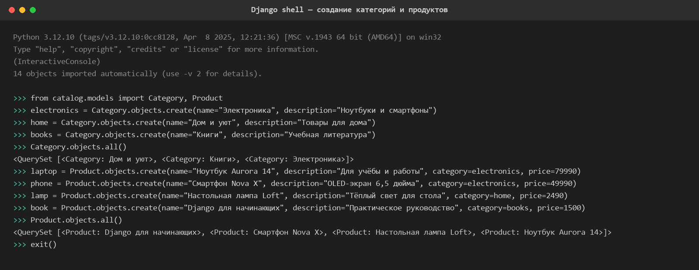
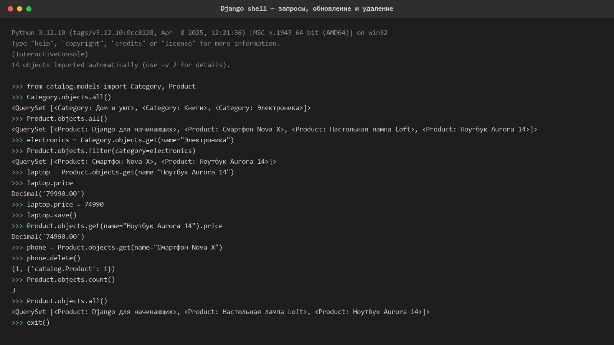
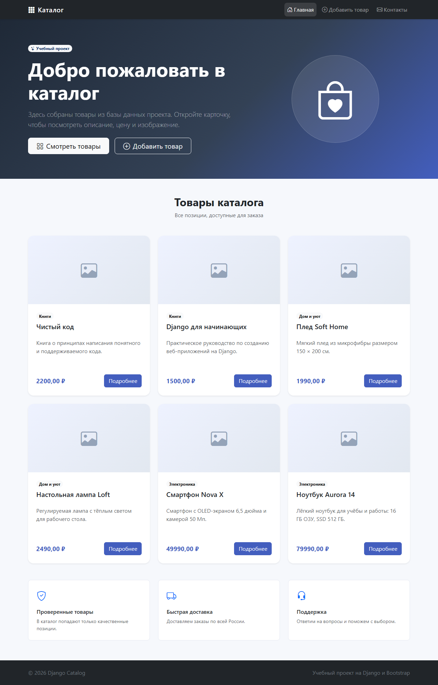
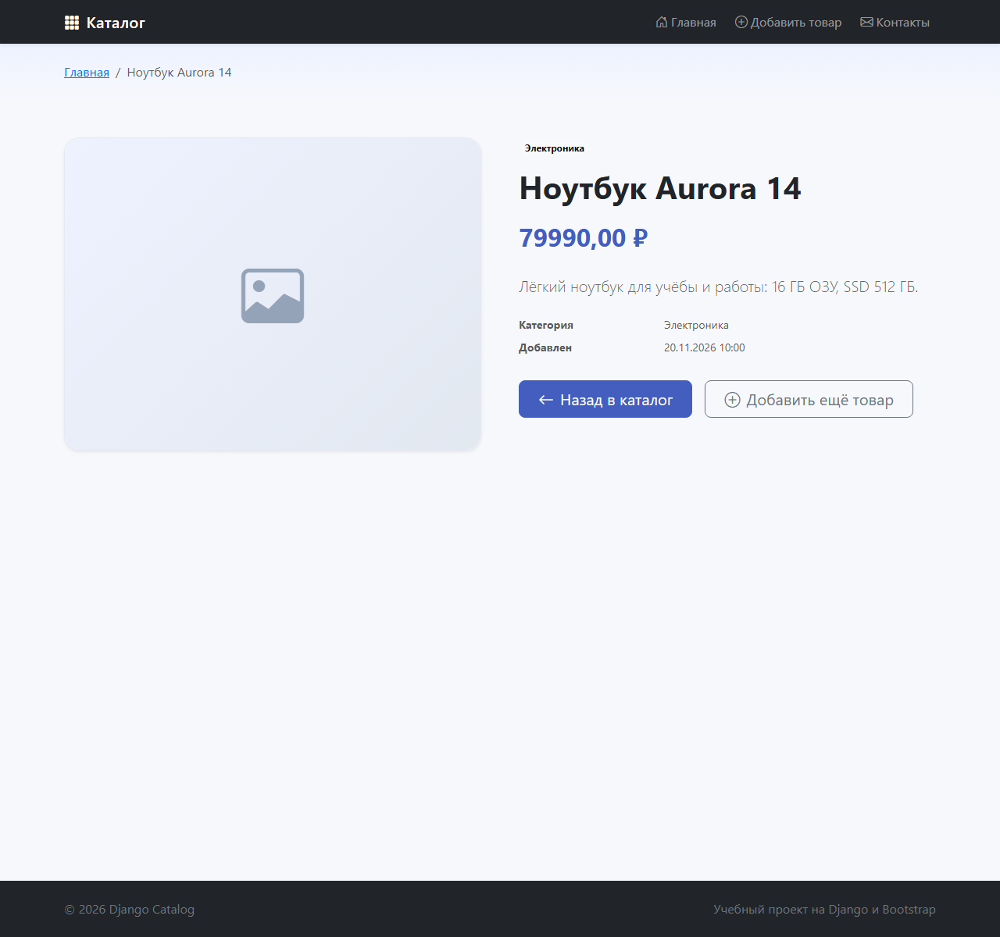
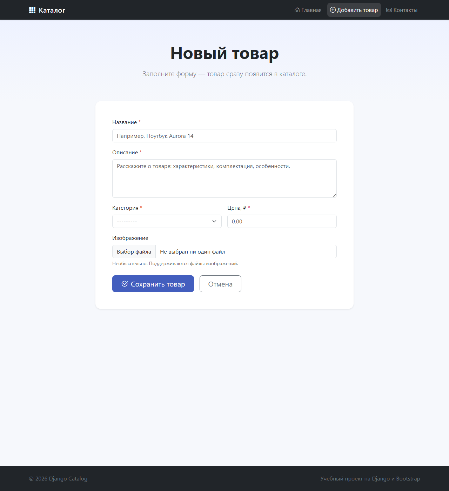

# Django Catalog

Учебный сайт-каталог на Django: главная страница, контакты и каталог товаров
с хранением данных в PostgreSQL.

## Краткое описание

**Django Catalog** — учебный веб-проект, который демонстрирует базовую структуру
приложения на Django: маршрутизацию, контроллеры, шаблоны, модели, миграции,
административную панель, работу с медиафайлами и загрузку тестовых данных.

На сайте есть главная страница со списком товаров, страницы подробной информации
о товаре, добавления товара и контактная информация. Товары и категории хранятся
в PostgreSQL и доступны для управления через административную панель.

## Что реализовано

- Django-проект `catalog_project` и приложение `catalog`;
- модели `Category` и `Product`, связанные через `ForeignKey`;
- миграции для моделей каталога;
- подключение PostgreSQL через переменные окружения;
- медиафайлы для изображений товаров (`MEDIA_URL`, `MEDIA_ROOT`);
- настройка административной панели: списки, фильтр по категории и поиск;
- фикстуры с категориями и продуктами;
- кастомная команда `load_test_data` для очистки и загрузки тестовых данных;
- главная страница со списком товаров из базы данных (`Product.objects.all()`);
- страница товара `/products/<int:pk>/` с названием, описанием, ценой и изображением;
- форма добавления товара с обязательными полями, валидацией и сохранением в базу;
- HTML-шаблоны с наследованием от `base.html` и оформлением Bootstrap 5;
- общее меню и карточка товара вынесены в переиспользуемые include-шаблоны;
- тесты страниц, товаров, формы, моделей и команды загрузки данных.

## Стек

- Python 3.12+
- Django 6.0
- PostgreSQL (проверено на PostgreSQL 18)
- psycopg2-binary
- Pillow
- python-dotenv
- IPython
- Bootstrap 5 (CDN)

## Структура проекта

```text
django-catalog/
├── catalog/
│   ├── fixtures/
│   │   ├── categories.json          # фикстура категорий
│   │   └── products.json            # фикстура продуктов
│   ├── management/commands/
│   │   └── load_test_data.py        # загрузка тестовых данных
│   ├── migrations/
│   │   └── 0001_initial.py
│   ├── templates/catalog/
│   │   ├── includes/
│   │   │   ├── menu.html            # общее меню сайта
│   │   │   └── product_card.html    # карточка товара
│   │   ├── base.html
│   │   ├── home.html
│   │   ├── contacts.html
│   │   ├── product_detail.html
│   │   └── product_form.html
│   ├── admin.py                     # настройки админки
│   ├── forms.py                     # форма добавления товара
│   ├── models.py                    # модели Category и Product
│   ├── tests.py
│   ├── urls.py
│   └── views.py
├── catalog_project/
│   ├── settings.py
│   └── urls.py
├── screenshots/                     # скриншоты работы в Django shell
├── static/css/style.css
├── .env.example                     # шаблон переменных окружения
├── .gitignore
├── manage.py
├── README.md
└── requirements.txt
```

## Модели

| Модель     | Поля                                                                 |
| ---------- | -------------------------------------------------------------------- |
| `Category` | `name`, `description`                                                |
| `Product`  | `name`, `description`, `image`, `category`, `price`, `created_at`, `updated_at` |

`Product.category` — внешний ключ на `Category`. При удалении категории её
продукты также удаляются (`on_delete=models.CASCADE`).

## Требования

- Python 3.12 или новее;
- pip;
- Git;
- PostgreSQL (локальный сервер или удалённая база).

## Настройка окружения

1. Клонируйте репозиторий и перейдите в его директорию:

   ```bash
   git clone https://github.com/Basrik-alt/django-catalog.git
   cd django-catalog
   ```

2. Создайте и активируйте виртуальное окружение:

   **Windows (PowerShell):**

   ```powershell
   python -m venv .venv
   .\.venv\Scripts\Activate.ps1
   ```

   **Linux / macOS:**

   ```bash
   python3 -m venv .venv
   source .venv/bin/activate
   ```

3. Установите зависимости:

   ```bash
   pip install -r requirements.txt
   ```

4. Создайте базу данных PostgreSQL, например через `psql`:

   ```bash
   psql -U postgres -c "CREATE DATABASE django_catalog WITH ENCODING 'UTF8';"
   ```

   То же самое можно сделать в pgAdmin: правой кнопкой по **Databases** →
   **Create** → **Database…**, имя базы — `django_catalog`.

5. Создайте файл `.env` на основе шаблона:

   **Windows:**

   ```powershell
   Copy-Item .env.example .env
   ```

   **Linux / macOS:**

   ```bash
   cp .env.example .env
   ```

   Откройте `.env` и укажите пароль пользователя PostgreSQL в `DB_PASSWORD`.
   Файл `.env` добавлен в `.gitignore` и не попадает в репозиторий.

6. Примените миграции:

   ```bash
   python manage.py migrate
   ```

7. Создайте суперпользователя для входа в админку:

   ```bash
   python manage.py createsuperuser
   ```

8. Загрузите тестовые данные одним из способов:

   ```bash
   python manage.py load_test_data
   ```

   или напрямую через фикстуры:

   ```bash
   python manage.py loaddata categories.json products.json
   ```

9. Запустите сервер разработки:

   ```bash
   python manage.py runserver
   ```

## Адреса

- главная страница со списком товаров — <http://127.0.0.1:8000/>
- страница товара — <http://127.0.0.1:8000/products/1/>
- добавление товара — <http://127.0.0.1:8000/products/add/>
- контакты — <http://127.0.0.1:8000/contacts/>
- административная панель — <http://127.0.0.1:8000/admin/>

## Страницы и форма

- **Главная** получает товары через `Product.objects.all()` и выводит их циклом
  ``. Карточки одинаковой высоты, описание обрезается до 100 символов.
- **Страница товара** открывается по адресу `/products/<int:pk>/`, имя маршрута —
  `product_detail`. Контроллер получает объект через `get_object_or_404` и передаёт
  его в шаблон. На странице есть название, описание, цена, категория и изображение.
- **Форма добавления товара** построена на `ModelForm`. Поля «Название»,
  «Описание», «Категория» и «Цена» обязательны. Дополнительно проверяется, что
  название не короче 3 символов, а цена больше нуля. При ошибках форма возвращается
  с сообщениями, при успехе товар сохраняется в базу и открывается его страница.
- Общие части вынесены в `catalog/includes/menu.html` и
  `catalog/includes/product_card.html`; все страницы наследуют `base.html`.

## Переменные окружения

| Переменная            | Назначение                              | Пример                       |
| --------------------- | --------------------------------------- | ---------------------------- |
| `DJANGO_SECRET_KEY`   | секретный ключ Django                   | `change-me`                  |
| `DJANGO_DEBUG`        | режим отладки                           | `True`                       |
| `DJANGO_ALLOWED_HOSTS`| разрешённые хосты через запятую         | `127.0.0.1,localhost`        |
| `DB_ENGINE`           | backend базы данных                     | `django.db.backends.postgresql` |
| `DB_NAME`             | имя базы данных                         | `django_catalog`             |
| `DB_USER`             | пользователь PostgreSQL                 | `postgres`                   |
| `DB_PASSWORD`         | пароль пользователя PostgreSQL          | `your_password`              |
| `DB_HOST`             | хост базы данных                        | `127.0.0.1`                  |
| `DB_PORT`             | порт базы данных                        | `5432`                       |

## Административная панель

- **Категории:** в списке отображаются `id` и `name`, доступен поиск по названию.
- **Продукты:** в списке отображаются `id`, `name`, `price` и `category`,
  доступны фильтр по категории и поиск по `name` и `description`.

## Работа в Django shell

```bash
python manage.py shell
```

Примеры запросов:

```python
from catalog.models import Category, Product

Category.objects.all()
Product.objects.all()
electronics = Category.objects.get(name="Электроника")
Product.objects.filter(category=electronics)

product = Product.objects.get(name="Ноутбук Aurora 14")
product.price = 74990
product.save()
product.delete()
```

Скриншоты выполнения запросов находятся в папке `screenshots/`:





## Скриншоты страниц







## Фикстуры и тестовые данные

- `catalog/fixtures/categories.json` — три категории;
- `catalog/fixtures/products.json` — шесть продуктов;
- `python manage.py load_test_data` — удаляет текущие продукты и категории,
  затем загружает обе фикстуры. Связи между продуктами и категориями
  восстанавливаются по первичным ключам.

## Тесты

```bash
python manage.py test
```

Для создания тестовой базы данных пользователь PostgreSQL должен иметь право
`CREATEDB` (у пользователя `postgres` оно есть по умолчанию).

## Git workflow

В проекте используется модель GitFlow:

- `main` — стабильная версия проекта;
- `develop` — ветка для интеграции изменений;
- `feature/homework-1` — ветка с выполнением текущего домашнего задания;
- изменения попадают в `develop` через pull request.
